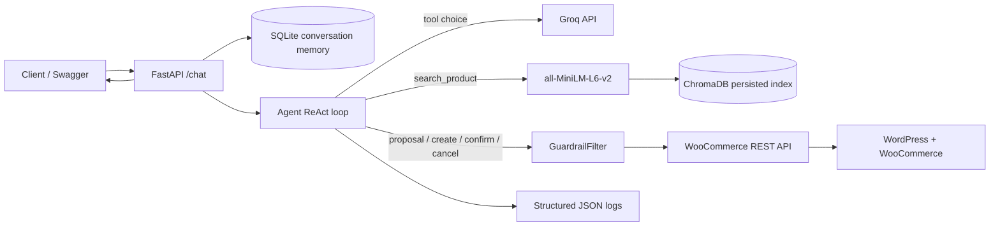

# Architecture de la démo

## Request flow

1. FastAPI loads conversation history from SQLite using the conversation ID; the client only supplies its latest message.
2. The agent asks the LLM whether a tool is needed. Advice and product lookup use `search_product`; ordinary questions can return directly.
3. Search embeds the query with `all-MiniLM-L6-v2` and searches the persistent cosine index. The current production distance threshold remains `0.70`.
4. Order lifecycle calls pass through `GuardrailFilter`. Product and quantity are validated against WooCommerce, a server-held proposal anchors the order values, and confirmation needs explicit user intent.
5. The API stores the returned assistant/tool messages. Logs record request, LLM attempt, tool and guardrail outcomes without user message text or credentials.

The LLM never gets direct network or database access. It only returns text or structured tool requests; server code owns catalog access, state transitions and WooCommerce calls.
